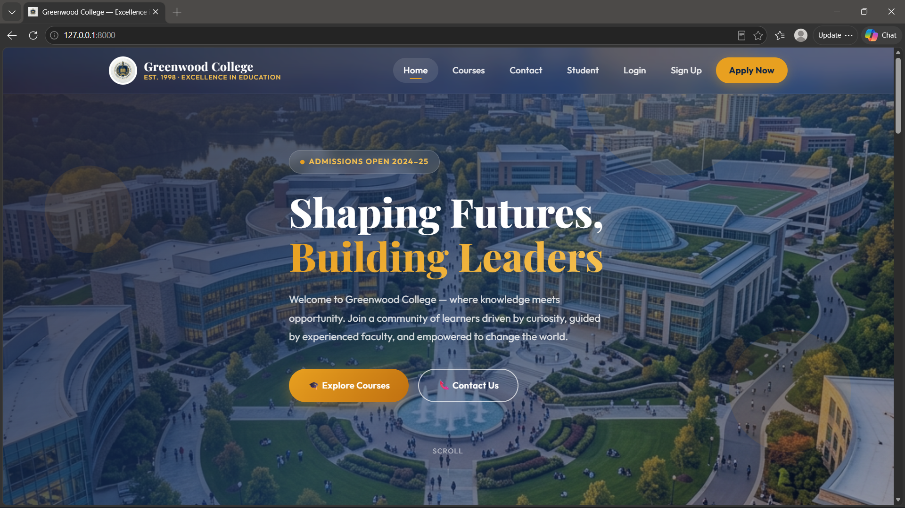

# Student Management System

A web application built with Python and Django for managing student records. Users can sign up, log in, and add, view, edit and delete their own students, and the home page shows the available courses.

The site is presented as a college website, "Greenwood College", with a navigation bar linking to Home, Courses, Contact, Student, Login and Sign Up.

I built this project to practice Django models, forms, authentication and CRUD operations.

## Features

- **User signup, login and logout** using Django's built-in authentication
- **Student records (CRUD):** add, view, update and delete students, each with a photo, name, date of birth, branch, phone number and address
- **Per-user data:** every student belongs to the logged-in user, and each user only sees and manages their own students
- **Course listing:** the home page shows courses stored in the database, with a detail page for each course (level, name, description, year and eligibility)
- **Image uploads** for course pictures and student photos
- **Contact page**
- **Delete confirmation page** before a student is removed

## Tech Stack

- **Backend:** Python, Django
- **Database:** MySQL
- **Frontend:** HTML, CSS (Django templates)

## Data Models

**Course**

| Field | Description |
| --- | --- |
| img | course image |
| level | course level |
| name | course name |
| desc | course description |
| year | duration or year |
| eligibility | who can join |

**Student**

| Field | Description |
| --- | --- |
| user | the logged-in user who owns this record |
| img | student photo |
| name | student name |
| dob | date of birth |
| branch | branch or department |
| ph | phone number |
| address | address |

## Pages

| Page | What it does |
| --- | --- |
| Home | lists all courses |
| Course detail | shows the details of one course |
| Contact | contact information |
| Signup / Login / Logout | account access |
| Student list | shows the logged-in user's students |
| Student detail | shows one student's information |
| Add / Update / Delete student | manage student records |

## Screenshots



## Getting Started

1. Clone the repository
   ```
   git clone https://github.com/lakshmims14/Student-Management-System.git
   cd Student-Management-System
   ```
2. Create and activate a virtual environment
   ```
   python -m venv venv
   venv\Scripts\activate        # Windows
   source venv/bin/activate     # macOS / Linux
   ```
3. Install the dependencies
   ```
   pip install -r requirements.txt
   ```
4. Set up the MySQL database. Install MySQL and create a database:
   ```
   CREATE DATABASE your_database_name;
   ```
   Then open `settings.py` and set the `DATABASES` section with your own details:
   ```
   DATABASES = {
       'default': {
           'ENGINE': 'django.db.backends.mysql',
           'NAME': 'your_database_name',
           'USER': 'your_mysql_username',
           'PASSWORD': 'your_mysql_password',
           'HOST': 'localhost',
           'PORT': '3306',
       }
   }
   ```
5. Create the database tables
   ```
   python manage.py migrate
   ```
6. Create an admin user and start the server
   ```
   python manage.py createsuperuser
   python manage.py runserver
   ```
7. Open `http://127.0.0.1:8000/admin/` and add a few courses so they appear on the home page. Then open `http://127.0.0.1:8000/`, sign up and start adding students.

## What I Learned

- Designing Django models and connecting records to users with a foreign key
- Building forms and handling file uploads with `ImageField`
- Implementing signup, login and logout with Django authentication
- Writing CRUD views and keeping each user's data separate
- Connecting a Django project to a MySQL database and running migrations

## Author

**Lakshmi MS** - Python Full Stack Developer (fresher)
[LinkedIn](https://www.linkedin.com/in/lakshmi-m-s-aa97a2293/) | [GitHub](https://github.com/lakshmims14)
